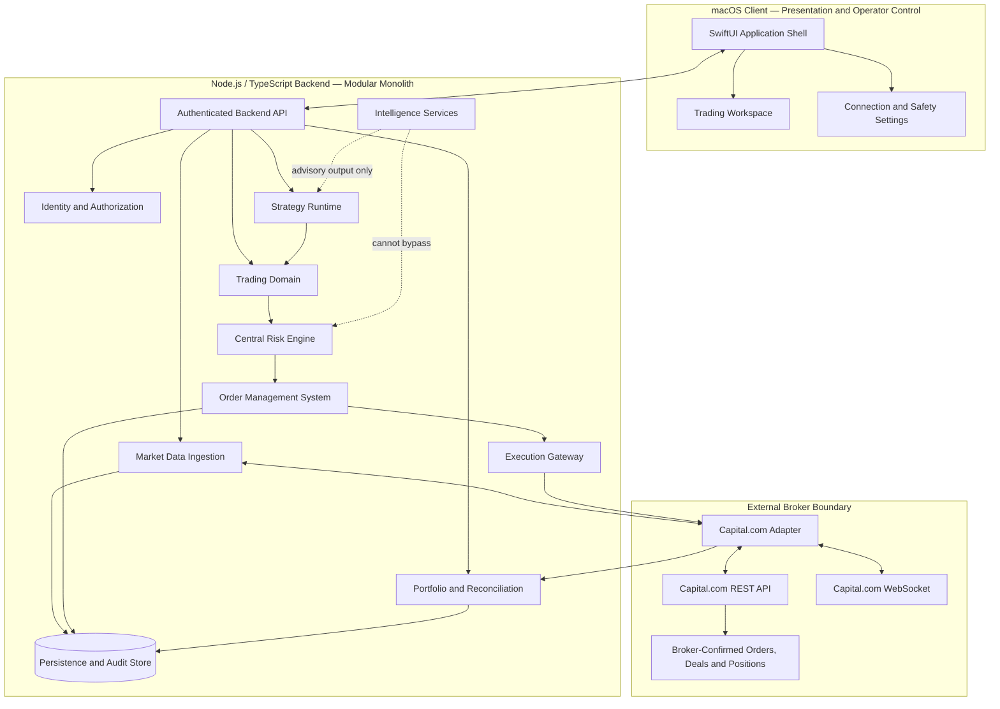
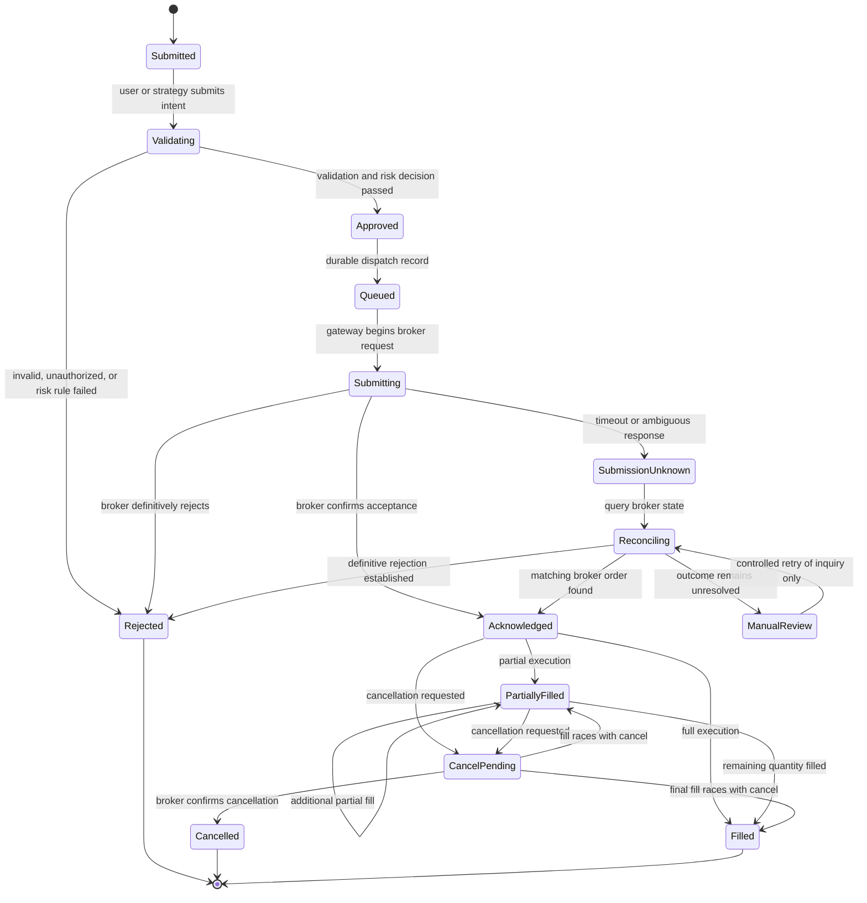
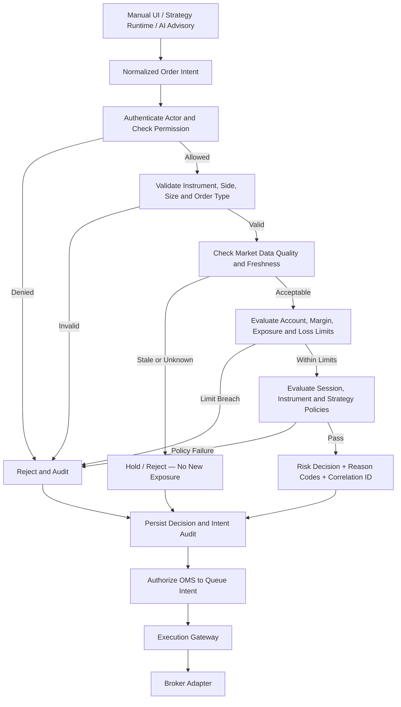
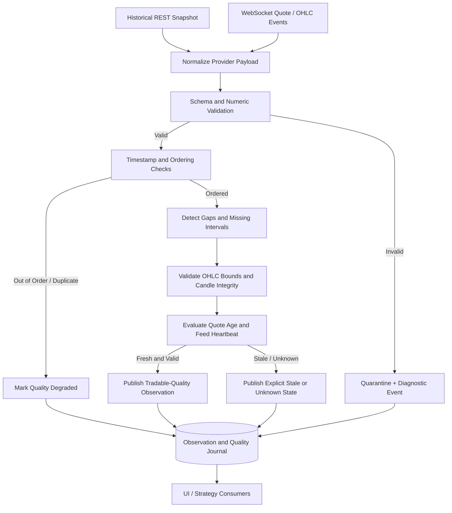
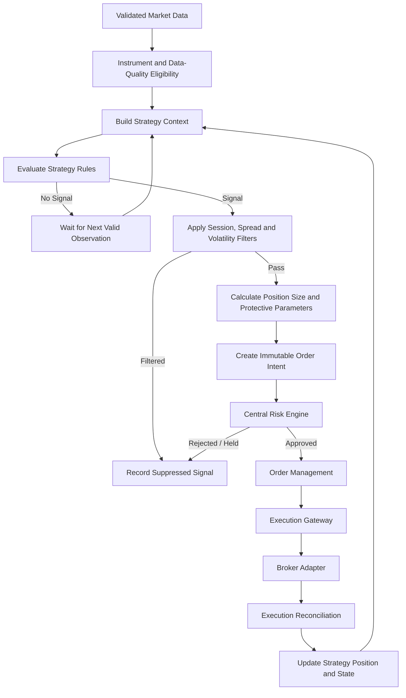
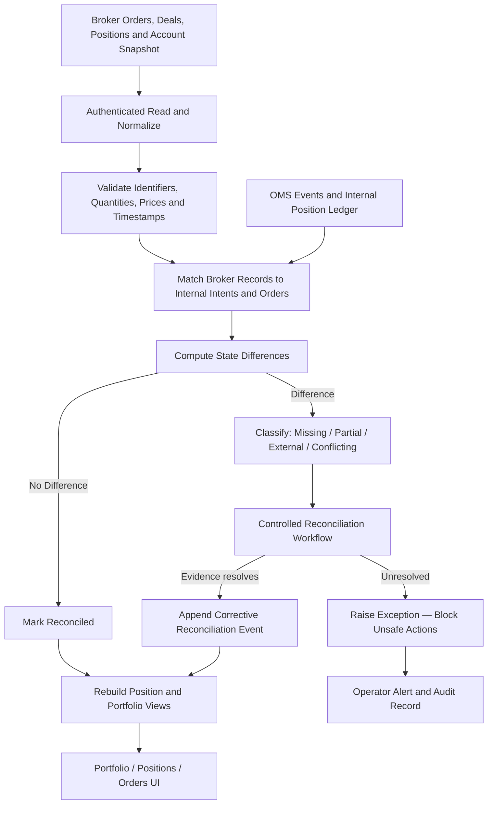
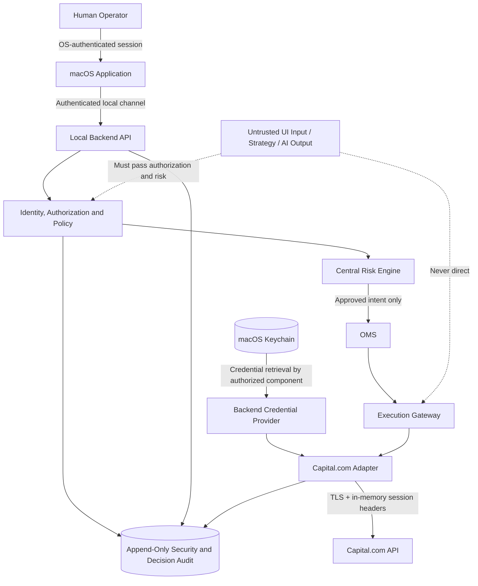
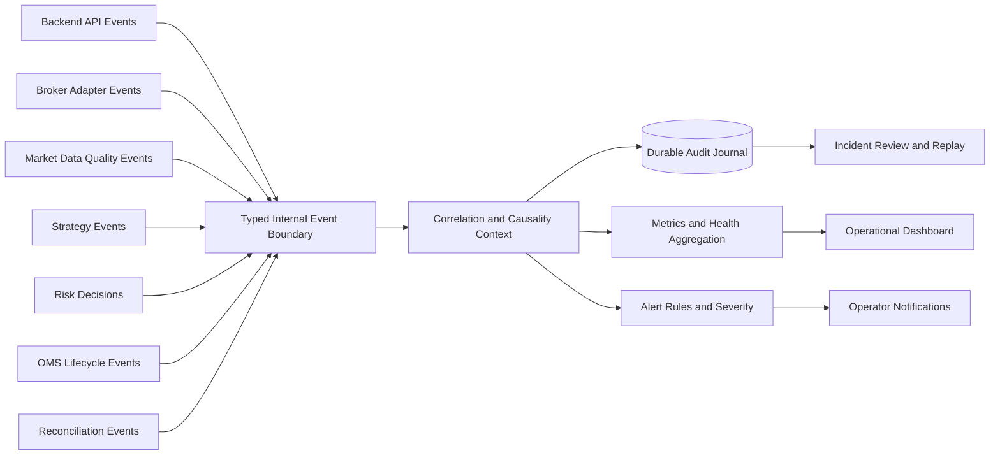
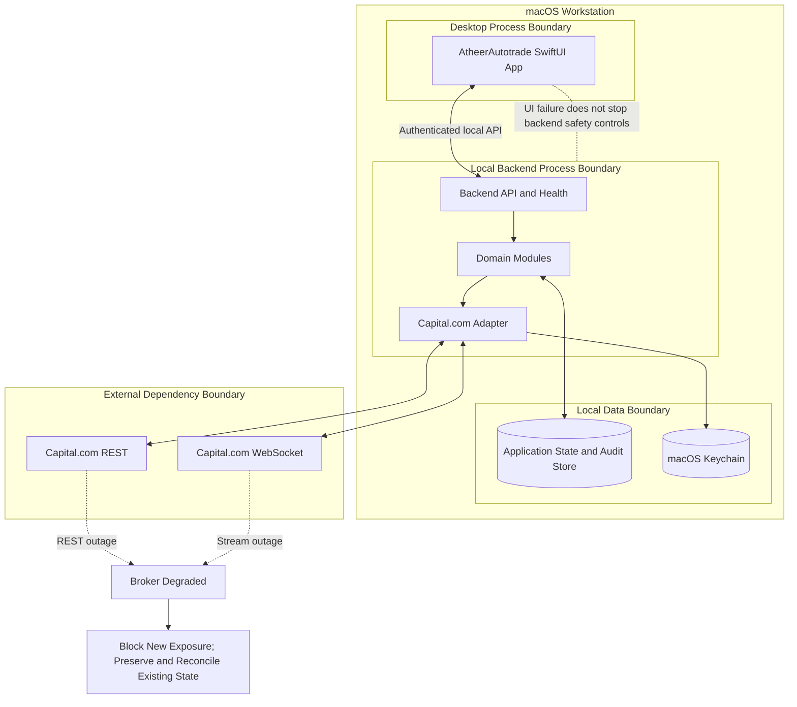

# ATHEER Trading Pro — Architecture Diagram Catalogue

**Product:** ATHEER Trading Pro  
**Repository identifier:** AtheerAutotrade (temporary technical name)  
**Document ID:** ATA-ARCH-DIAG-001  
**Status:** Architecture reference — reconstructed and adapted; not implementation evidence  
**Created:** 2026-11-12  
**Source lineage:** Prior ATHEER Trading Pro work, ATP-GAI-02 / ATP-GAI-02-R1.1 (2026-11-11)

## 1. Purpose and provenance

This document preserves the ten-diagram architecture suite previously defined for ATHEER Trading Pro and adapts it to the independently governed **AtheerAutotrade** project.

The prior conversation record preserved the ten diagram titles and scope, but did **not** preserve the original verbatim Mermaid source blocks. The diagrams below are therefore **reconstructed Mermaid definitions**, based on the recovered titles, prior architecture decisions, and the current AtheerAutotrade repository's authoritative documents. They must not be represented as byte-for-byte copies of the earlier diagrams.

These diagrams describe the intended architecture and control flows. They do not assert that the depicted modules are implemented, connected, tested, or operational. Current implementation and verification state remains governed by:
- [System Overview](../SYSTEM_OVERVIEW.md)
- [Module Boundaries](../MODULE_BOUNDARIES.md)
- [Implementation Status](../../engineering/IMPLEMENTATION_STATUS.md)
- [Task Register](../../engineering/TASK_REGISTER.md)
- [ADR-0003 — Capital.com Read-Only Market Connectivity](../../decisions/ADR-0003-CAPITAL-COM-MARKET-CONNECTIVITY.md)
- [ADR-0004 — ATHEER Production Architecture Baseline](../../decisions/ADR-0004-ATHEER-PRODUCTION-ARCHITECTURE.md)

## 2. Diagram index

| ID | Diagram | Primary concern |
|---|---|---|
| D01 | Complete System Architecture | System components and trust boundaries |
| D02 | OMS 14-State Machine | Order-intent lifecycle and terminal outcomes |
| D03 | Centralized Risk Validation | Mandatory pre-trade control |
| D04 | Broker Connectivity & Reconnection | Session and transport recovery |
| D05 | Real-Time Market Data & Freshness | Validation, quality, and stale-data handling |
| D06 | Algorithmic Strategy Execution | Signal-to-authorized-intent flow |
| D07 | Position & Portfolio Reconciliation | Broker-authoritative state |
| D08 | Security & Authorization | Identity, secrets, and authorization |
| D09 | Notification & Event Telemetry | Audit and operational observability |
| D10 | Deployment & Failure Isolation | Runtime boundaries and degraded operation |

---

## D01 — Complete System Architecture

**Intent:** Show the intended end-to-end component topology and enforce the separation between presentation, domain decisions, risk, order management, broker protocol, and broker-confirmed state.

**Current status:** The macOS shell, minimal backend, provider-neutral Instrument model, and read-only Capital.com adapter source exist at different verification levels. The complete flow below is a target architecture, not a claim of operational integration.



## D02 — OMS 14-State Machine

**Intent:** Define an explicit, auditable order-intent lifecycle. State names describe the proposed domain contract; exact transitions and persistence semantics require a dedicated OMS ADR before implementation.

**Safety invariant:** Unknown submission outcomes must enter an uncertainty/reconciliation path. They must never trigger blind duplicate submission.



This reconstructed state machine contains **14 named states**: Submitted, Validating, Rejected, Approved, Queued, Submitting, SubmissionUnknown, Reconciling, Acknowledged, PartiallyFilled, Filled, CancelPending, Cancelled, and ManualReview. The historical ATP-GAI-02 title referred to a 14-state OMS model, but the original verbatim state enumeration was not recovered. This is a newly reconstructed 14-state proposal, not a claim that it reproduces the earlier source exactly.

## D03 — Centralized Risk Validation

**Intent:** Enforce one mandatory risk decision point for manual, automated, and AI-assisted order intents.



**Invariant:** No UI, strategy, AI component, or broker adapter may call the execution interface without an approved Risk Engine decision associated with the exact intent and its immutable correlation/idempotency identity.

## D04 — Broker Connectivity & Reconnection

**Intent:** Model session establishment, REST and WebSocket lifecycle, bounded recovery, and explicit degraded states.

```mermaid
stateDiagram-v2
    [*] --> Disconnected
    Disconnected --> LoadingCredentials: connection requested
    LoadingCredentials --> AuthenticationPending: credentials retrieved securely
    LoadingCredentials --> CredentialError: Keychain/provider failure
    AuthenticationPending --> SessionActive: broker authentication succeeds
    AuthenticationPending --> AuthenticationFailed: broker rejects credentials
    SessionActive --> Subscribing: establish market subscriptions
    Subscribing --> Streaming: subscriptions acknowledged
    Streaming --> Degraded: heartbeat missed / stale feed / transport error
    Degraded --> Reconnecting: bounded backoff begins
    Reconnecting --> SessionActive: session valid and transport restored
    Reconnecting --> AuthenticationPending: session expired; re-authenticate
    Reconnecting --> Disconnected: retry budget exhausted
    CredentialError --> Disconnected: operator correction
    AuthenticationFailed --> Disconnected: operator correction
    Streaming --> Disconnecting: operator requests disconnect
    Disconnecting --> Disconnected
```

Operational requirements:
- Credentials are supplied through a secure credential-provider boundary.
- CST and X-SECURITY-TOKEN remain memory-only.
- REST session keepalive and WebSocket ping follow provider-documented limits.
- Reconnection is bounded and observable; successful transport reconnection alone does not establish data continuity.
- Demo and Live environments must be explicitly isolated. Live URL support does not authorize live onboarding or trading.

## D05 — Real-Time Market Data & Freshness

**Intent:** Ensure consumers receive validated observations with explicit quality and freshness states rather than treating transport receipt as proof of usable market data.



No consumer may infer a price, fill a missing candle, or silently treat stale/unknown data as current. Thresholds must be configuration governed by instrument/feed requirements and recorded decisions; do not hard-code undocumented provider assumptions.

## D06 — Algorithmic Strategy Execution

**Intent:** Show the strategy lifecycle from validated market observations to a risk-governed order intent. Strategy and AI modules do not possess broker execution authority.



Strategies may calculate signals and proposed parameters. They may not submit orders directly, weaken risk policy, or interpret an unconfirmed broker response as a fill.

## D07 — Position & Portfolio Reconciliation

**Intent:** Make broker-confirmed account and execution state authoritative, while preserving internal intent and event history.



Internal projections must not overwrite broker-confirmed facts. Unmatched or conflicting execution records require explicit exception handling; never fabricate fills or silently discard external activity.

## D08 — Security & Authorization

**Intent:** Define the trust boundaries for the desktop client, local backend, credential storage, broker session, and privileged trading operations.



Security controls:
- Never place credentials, API keys, CST, or X-SECURITY-TOKEN in Git, source, logs, crash reports, or ChatGPT.
- The local API must authenticate its client; loopback binding alone is not authentication.
- Enforce least privilege, environment separation, request validation, rate limits where appropriate, and auditable authorization decisions.
- LIVE remains disabled until separately approved safety controls and explicit operator authorization are in place.

## D09 — Notification & Event Telemetry

**Intent:** Provide traceability across service health, broker connectivity, data quality, risk decisions, OMS transitions, and operator alerts.



Every material transition should carry timestamp, event type, source, correlation ID, relevant entity identity, and a safe reason code. Secrets and sensitive payloads must be redacted before telemetry or audit serialization.

## D10 — Deployment & Failure Isolation

**Intent:** Keep the native client, backend process, persistence, and external broker as separately observable failure domains. A process-health endpoint must not imply broker or trading readiness.



Failure policy:
- Backend process health, broker session health, stream health, data freshness, and trading readiness are distinct statuses.
- A broker or market-data outage must block new exposure when required data or authorization is unavailable.
- Recovery must reconcile state before resuming dependent operations.
- Existing positions are not assumed closed or cancelled because the application or backend is unavailable.
- Deployment, restart, persistence recovery, backup, and disaster-recovery procedures require separate operational validation.

---

## 3. Inherited system-separation principle

The prior ATHEER Trading Pro design also distinguished **System A — Engineering Workbench** from **System B — ATHEER Production**, with no shared execution channel. This is preserved here as a design lineage note, not asserted as an existing AtheerAutotrade deployment topology:

- Engineering and test tooling must not inherit production broker credentials or execution authority.
- Production execution authority belongs only to the production-controlled backend path and its explicit safety gates.
- Shared source code or documentation does not imply shared runtime credentials, sessions, queues, or execution channels.

## 4. Governance and change control

1. Mermaid source in this repository is the editable, version-controlled source of truth for these diagrams.
2. Rendered images are optional outputs; they must never replace the Mermaid source.
3. Any change to module boundaries, execution authority, risk gates, security trust boundaries, or broker lifecycle must be reflected in the relevant diagram and an ADR where consequential.
4. Diagram changes must be reviewed against the current implementation status. Mark intended components as target architecture until implementation evidence exists.
5. Do not remove historical states or transitions merely to make a diagram appear simpler; document supersession and rationale.
6. The exact original ATP-GAI-02 Mermaid source was not recovered. If the user later provides the original blocks or archive, compare them and preserve provenance rather than silently overwriting this reconstructed edition.
